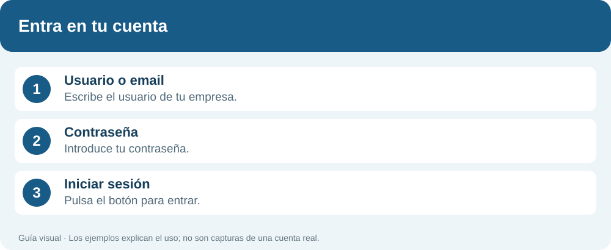
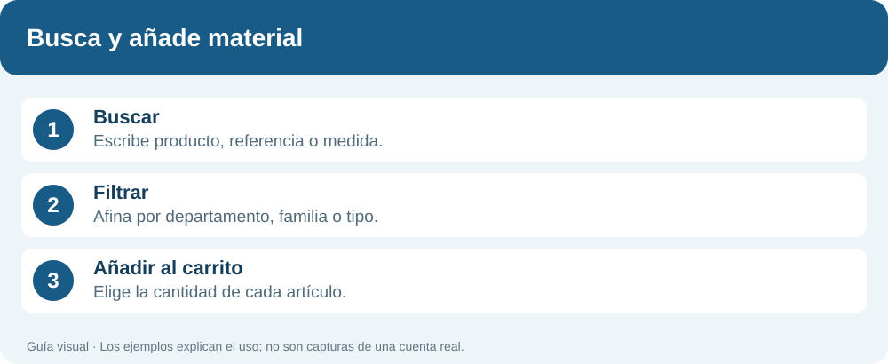
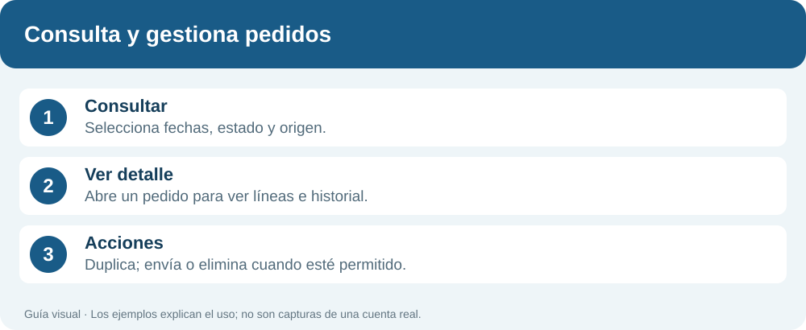
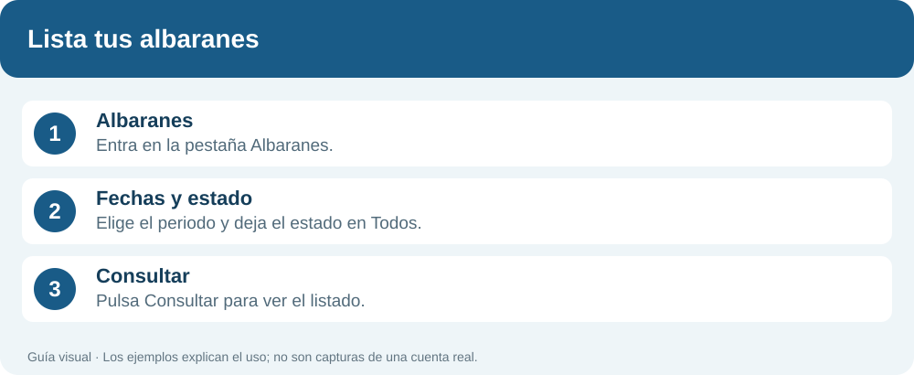
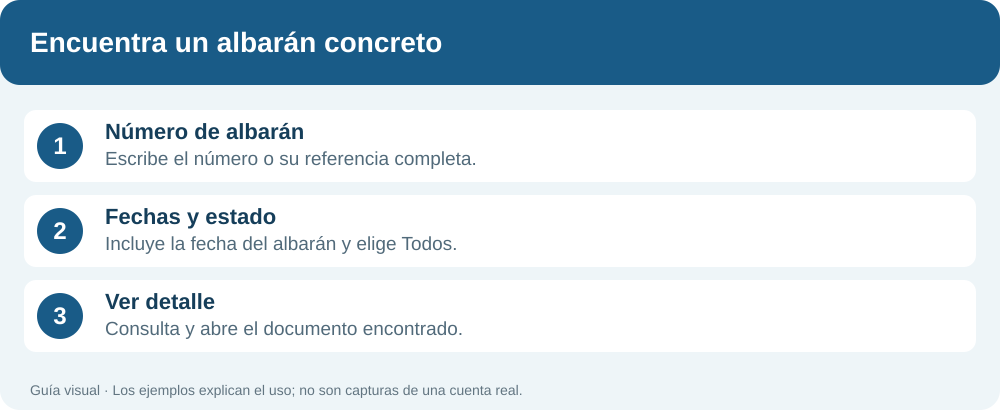
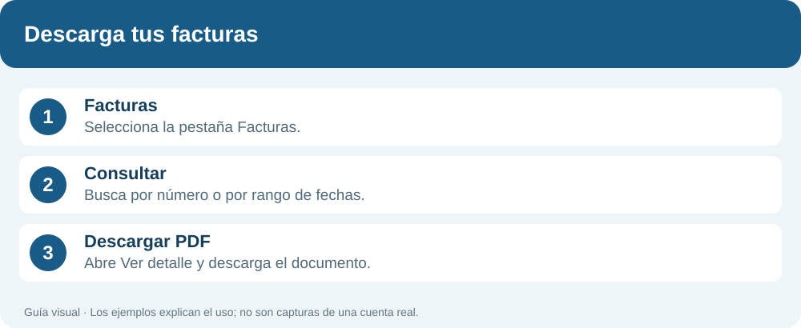
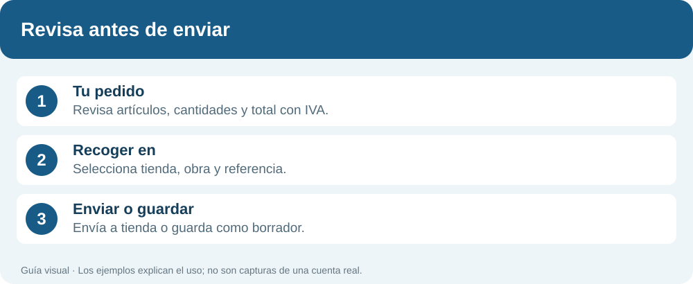
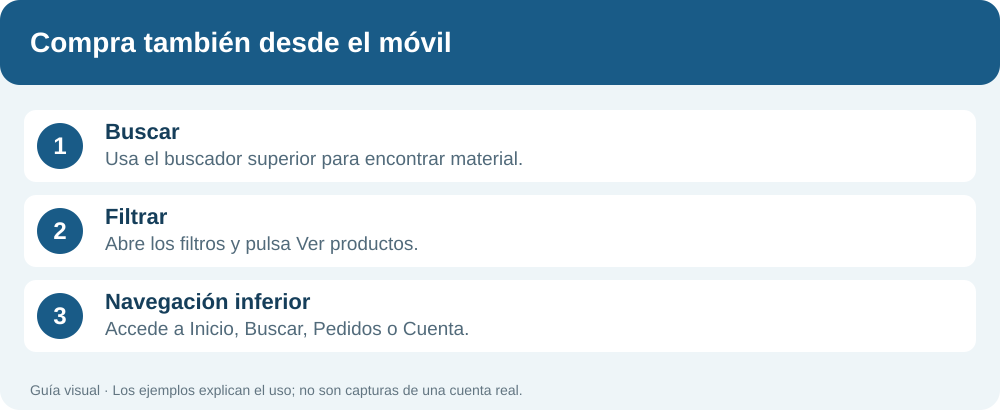

# ¿Qué quieres hacer? · Manual de Bermúdez Ulloa

**Guía práctica para clientes · 11 de octubre de 2026**

Elige la tarea que necesitas. Cada apartado indica dónde entrar, qué pulsar y qué resultado esperar. Las ilustraciones explican los pasos; no son capturas de una cuenta real.

## 1. Quiero entrar en la web

1. Abre la dirección de la extranet que te haya facilitado Bermúdez Ulloa.
2. Escribe tu **Usuario o email** y tu **Contraseña**.
3. Pulsa **Iniciar sesión**.

**¿Qué veré?** La pantalla de Inicio, con el catálogo, tus pedidos y los accesos a documentos.

**Si no puedo entrar:** revisa los datos escritos. Si no tienes una cuenta o no recuerdas la contraseña, contacta con Bermúdez Ulloa.

## 2. Quiero hacer un pedido

1. Pulsa **Explorar catálogo** desde Inicio, o escribe directamente en el buscador superior.
2. Busca el producto por nombre, referencia o medida. Ejemplos: **racor latón**, **03065** o **1/2**.
3. Revisa la descripción, el precio y la disponibilidad del artículo.
4. Indica las unidades y pulsa **Añadir al carrito**. Repite con los demás materiales.
5. Abre **Mi carrito** y comprueba artículos, cantidades y total con IVA.
6. Selecciona **Recoger en**. Completa Obra, Referencia cliente y Observaciones si lo necesitas.
7. Pulsa **Enviar pedido a tienda**.

**¿Qué pasará?** El pedido se enviará y podrás consultarlo en **Mis pedidos**.

**Quiero seguir buscando:** pulsa **Seguir comprando** en el carrito. Los artículos permanecen en el carrito de tu sesión.

**No quiero enviarlo todavía:** marca **Guardar como borrador** y pulsa **Guardar borrador**. Después lo encontrarás en Mis pedidos, seleccionando el estado Borrador. Guardarlo no lo envía a preparación.

## 3. Quiero ver mis últimos pedidos

1. Entra en **Mis pedidos** desde el menú o pulsa **Ver todos mis pedidos** en Inicio.
2. Elige las fechas **Desde** y **Hasta** que quieras revisar.
3. En **Estado**, selecciona **Todos** si quieres ver los pedidos de cualquier estado.
4. En **Origen**, selecciona **Todos** para incluir tanto WEB como No WEB.
5. Pulsa **Consultar**.
6. Abre **Ver detalle** en el pedido que te interese para ver artículos, cantidades e historial.

**¿Qué veré?** Los pedidos que coinciden con las fechas, el estado y el origen seleccionados.

**No encuentro un pedido:** amplía las fechas y revisa los otros filtros. Pulsa **Actualizar pedidos** para volver a consultar con los filtros elegidos.

**Quiero repetir un pedido:** abre su detalle y pulsa **Duplicar pedido** cuando esté disponible. Revisa el contenido antes de enviarlo.

## 4. Quiero listar mis albaranes

1. Entra en **Albaranes y facturas**.
2. Selecciona la pestaña **Albaranes**.
3. Deja vacío **Número de albarán** para listar documentos, en lugar de buscar uno concreto.
4. Elige las fechas **Desde** y **Hasta**.
5. Deja **Estado (opcional)** en **Todos**, o elige **Facturado** o **No facturado**.
6. Pulsa **Consultar**.

**¿Qué veré?** El listado de albaranes que coincide con los filtros. El encabezado muestra la cantidad de documentos y su importe total.

**Quiero ver los materiales:** abre **Ver detalle** en un albarán.

**Quiero guardar el listado:** pulsa **Descargar Excel**. El Excel utiliza el número o las fechas de la consulta, pero no aplica el filtro opcional de estado. **Imprimir listado** imprime el resultado visible.

## 5. Quiero buscar un albarán concreto

1. Entra en **Albaranes y facturas → Albaranes**.
2. Escribe el número en **Número de albarán**. Puedes utilizar **12345** o la referencia completa **2026-AL-12345**.
3. El campo admite hasta **20 caracteres**. Elige un rango de fechas que incluya el albarán.
4. Deja **Estado (opcional)** en **Todos** si no conoces su estado.
5. Pulsa **Consultar** y abre **Ver detalle**.

**¿Qué veré?** El albarán o los documentos que coincidan con el número y los filtros. La referencia completa permite precisar año y serie.

**No aparece:** amplía las fechas, selecciona Todos y comprueba el número.

**Quiero abrir su factura:** dentro del detalle, pulsa el número de **Factura relacionada**. La web abre Facturas y busca esa referencia sin limitarla por las fechas.

## 6. Quiero descargar mis facturas

1. Entra en **Albaranes y facturas** y selecciona **Facturas**.
2. Para listar varias, deja vacío el número y selecciona **Desde** y **Hasta**.
3. Para buscar una concreta, escribe su número (**12345**) o la referencia completa (**2026-FR-12345**). Cuando hay un número, las fechas no limitan la búsqueda.
4. Pulsa **Consultar**.
5. Abre **Ver detalle** en la factura y pulsa **Descargar PDF**.

**¿Qué obtendré?** El PDF de la factura seleccionada, que podrás guardar o imprimir. Para descargar varias facturas en PDF, repite la descarga en cada documento.

**Quiero un listado en una hoja de cálculo:** pulsa **Descargar Excel**. Esto exporta el listado; no es una descarga conjunta de los PDF.

**Vengo desde un albarán:** pulsa su número de Factura relacionada. La factura se busca por número sin usar las fechas del albarán.

## 7. Quiero salir del carrito o guardar para después

| Quiero… | Qué debo pulsar |
|---|---|
| Seguir buscando material | **Seguir comprando**. |
| Cerrar el carrito sin enviar | **×** en la cabecera del carrito. |
| Guardar el pedido para revisarlo | **Guardar como borrador → Guardar borrador**. |
| Enviar un borrador guardado | **Mis pedidos → Borrador → Consultar → Convertir en pendiente**. |
| Quitar un artículo del carrito | **×** junto al artículo. |
| Eliminar un pedido permitido | **Mis pedidos → Ver detalle → Eliminar pedido**, y confirma. |

**Al eliminar un pedido**, solo desaparece ese pedido y la lista se actualiza. La opción aparece únicamente para determinados pedidos locales sin número EXIT.

## 8. Quiero usar el móvil o cerrar mi sesión

**En el móvil:** utiliza el buscador superior y la botonera inferior **Inicio / Buscar / Pedidos / Cuenta**. Pulsa **Filtrar** para afinar el catálogo y el botón **Ver productos** para regresar al resultado. En **Menú → Manual de uso** puedes volver a abrir esta guía o descargarla.

**Para cerrar sesión:** pulsa **Salir**, especialmente cuando compartas el equipo. Las flechas del navegador no sustituyen el cierre de sesión.

**Si dejo de usar la web:** por defecto la sesión vence después de **15 minutos de inactividad**. Tu empresa puede configurar otro tiempo. Cuando venza, inicia sesión de nuevo. Las actualizaciones automáticas no cuentan como actividad del usuario.

## Cómo mantener este manual

Edita `docs/manual/README.md` y las ilustraciones de `docs/manual/assets/`. Regenera la descarga con `python docs/manual/build_pdf.py` (requiere reportlab). El resultado se publica en `frontend/public/manual-de-uso.pdf`. Guarda y revisa los cambios en develop antes de pasarlos a producción.
