# ¿Qué quieres hacer? · Manual de Bermúdez Ulloa

**Guía práctica para clientes · 11 de octubre de 2026**

Elige la tarea que necesitas. Cada apartado indica dónde entrar, qué pulsar y qué resultado esperar. Cada paso lleva una imagen referencial pequeña a su derecha en el PDF. Las ilustraciones explican los pasos; no son capturas de una cuenta real.

## 1. Quiero entrar en la web

1. Abre la dirección de la extranet que te haya facilitado Bermúdez Ulloa.

2. Escribe tu **Usuario o email** y tu **Contraseña**.

3. Pulsa **Iniciar sesión**.

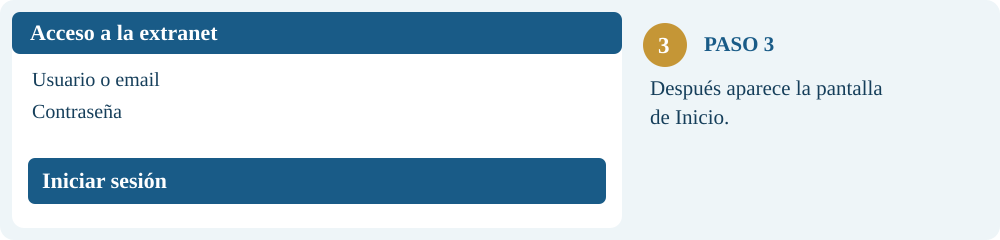

**¿Qué veré?** La pantalla de Inicio, con el catálogo, tus pedidos y los accesos a documentos.

**Si no puedo entrar:** revisa los datos escritos. Si no tienes una cuenta o no recuerdas la contraseña, contacta con Bermúdez Ulloa.

## 2. Quiero hacer un pedido

1. Pulsa **Explorar catálogo** desde Inicio, o escribe directamente en el buscador superior.

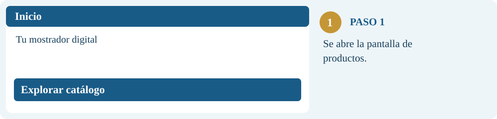

2. Busca el producto por nombre, referencia o medida. Ejemplos: **racor latón**, **03065** o **1/2**.

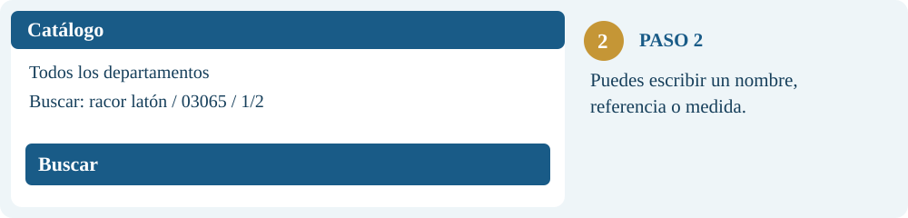

3. Revisa la descripción, el precio y la disponibilidad del artículo.

4. Indica las unidades y pulsa **Añadir al carrito**. Repite con los demás materiales.

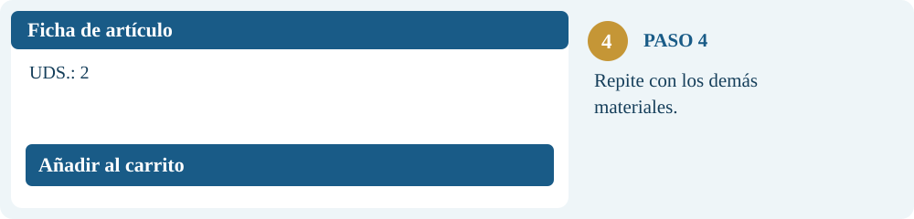

5. Abre **Mi carrito** y comprueba artículos, cantidades y total con IVA.

6. Selecciona **Recoger en**. Completa Obra, Referencia cliente y Observaciones si lo necesitas.

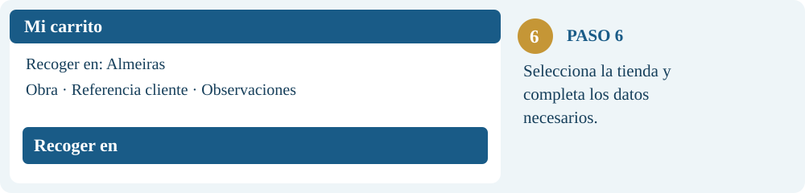

7. Pulsa **Enviar pedido a tienda**.

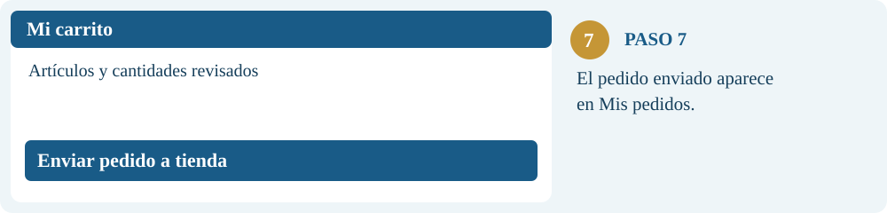

**¿Qué pasará?** El pedido se enviará y podrás consultarlo en **Mis pedidos**.

**Quiero seguir buscando:** pulsa **Seguir comprando** en el carrito. Los artículos permanecen en el carrito de tu sesión.

**No quiero enviarlo todavía:** marca **Guardar como borrador** y pulsa **Guardar borrador**. Después lo encontrarás en Mis pedidos, seleccionando el estado Borrador. Guardarlo no lo envía a preparación.

## 3. Quiero ver mis últimos pedidos

1. Entra en **Mis pedidos** desde el menú o pulsa **Ver todos mis pedidos** en Inicio.

2. Elige las fechas **Desde** y **Hasta** que quieras revisar.

3. En **Estado**, selecciona **Todos** si quieres ver los pedidos de cualquier estado.

4. En **Origen**, selecciona **Todos** para incluir tanto WEB como No WEB.

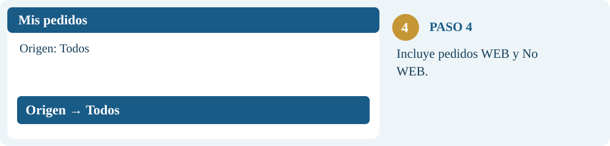

5. Pulsa **Consultar**.

6. Abre **Ver detalle** en el pedido que te interese para ver artículos, cantidades e historial.

**¿Qué veré?** Los pedidos que coinciden con las fechas, el estado y el origen seleccionados.

**No encuentro un pedido:** amplía las fechas y revisa los otros filtros. Pulsa **Actualizar pedidos** para volver a consultar con los filtros elegidos.

**Quiero repetir un pedido:** abre su detalle y pulsa **Duplicar pedido** cuando esté disponible. Revisa el contenido antes de enviarlo.

## 4. Quiero listar mis albaranes

1. Entra en **Albaranes y facturas**.

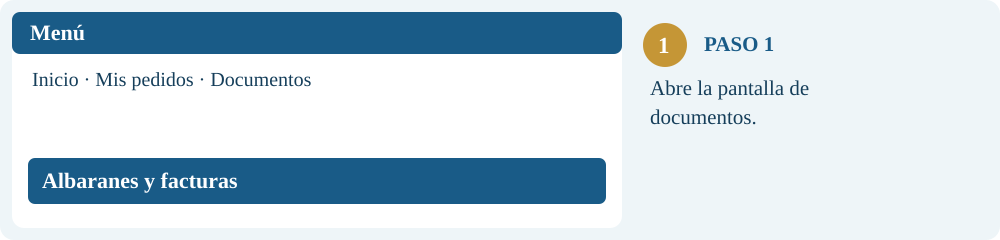

2. Selecciona la pestaña **Albaranes**.

3. Deja vacío **Número de albarán** para listar documentos, en lugar de buscar uno concreto.

4. Elige las fechas **Desde** y **Hasta**.

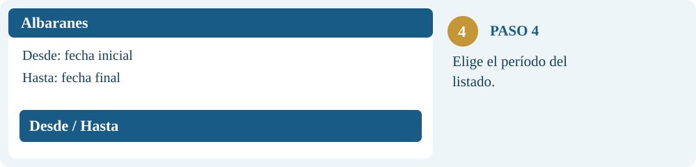

5. Deja **Estado (opcional)** en **Todos**, o elige **Facturado** o **No facturado**.

6. Pulsa **Consultar**.

**¿Qué veré?** El listado de albaranes que coincide con los filtros. El encabezado muestra la cantidad de documentos y su importe total.

**Quiero ver los materiales:** abre **Ver detalle** en un albarán.

**Quiero guardar el listado:** pulsa **Descargar Excel**. El Excel utiliza el número o las fechas de la consulta, pero no aplica el filtro opcional de estado. **Imprimir listado** imprime el resultado visible.

## 5. Quiero buscar un albarán concreto

1. Entra en **Albaranes y facturas → Albaranes**.

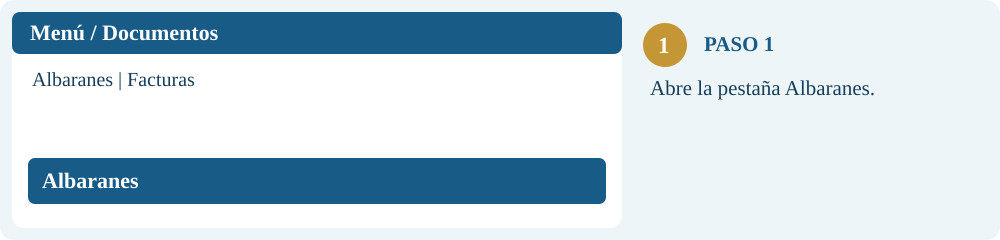

2. Escribe el número en **Número de albarán**. Puedes utilizar **12345** o la referencia completa **2026-AL-12345**.

3. El campo admite hasta **20 caracteres**. Elige un rango de fechas que incluya el albarán.

4. Deja **Estado (opcional)** en **Todos** si no conoces su estado.

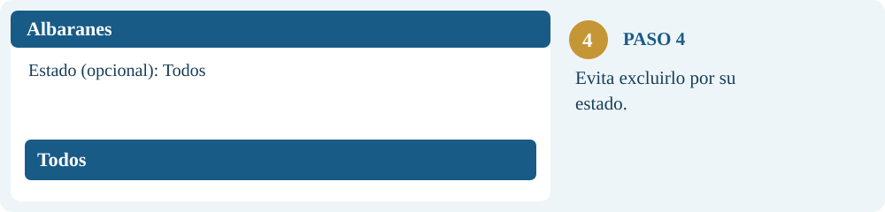

5. Pulsa **Consultar** y abre **Ver detalle**.

**¿Qué veré?** El albarán o los documentos que coincidan con el número y los filtros. La referencia completa permite precisar año y serie.

**No aparece:** amplía las fechas, selecciona Todos y comprueba el número.

**Quiero abrir su factura:** dentro del detalle, pulsa el número de **Factura relacionada**. La web abre Facturas y busca esa referencia sin limitarla por las fechas.

## 6. Quiero descargar mis facturas

1. Entra en **Albaranes y facturas** y selecciona **Facturas**.

2. Para listar varias, deja vacío el número y selecciona **Desde** y **Hasta**.

3. Para buscar una concreta, escribe su número (**12345**) o la referencia completa (**2026-FR-12345**). Cuando hay un número, las fechas no limitan la búsqueda.

4. Pulsa **Consultar**.

5. Abre **Ver detalle** en la factura y pulsa **Descargar PDF**.

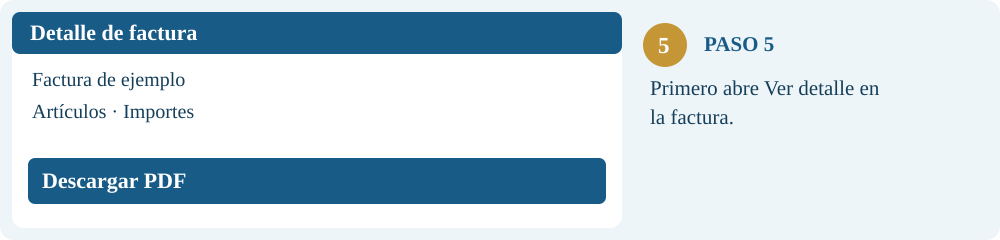

**¿Qué obtendré?** El PDF de la factura seleccionada, que podrás guardar o imprimir. Para descargar varias facturas en PDF, repite la descarga en cada documento.

**Quiero un listado en una hoja de cálculo:** pulsa **Descargar Excel**. Esto exporta el listado; no es una descarga conjunta de los PDF.

**Vengo desde un albarán:** pulsa su número de Factura relacionada. La factura se busca por número sin usar las fechas del albarán.

## 7. Quiero salir del carrito o guardar para después

1. Para continuar buscando, pulsa **Seguir comprando**. El carrito conserva tus artículos.

2. Para cerrar el carrito sin enviar, pulsa **×** en su cabecera.

3. Para guardar para después, marca **Guardar como borrador** y pulsa **Guardar borrador**.

4. Para enviar el borrador, entra en **Mis pedidos → Borrador → Consultar** y pulsa **Convertir en pendiente**.

5. Para quitar un artículo, pulsa **×** junto a su línea del carrito.

6. Para eliminar un pedido permitido, abre **Mis pedidos → Ver detalle → Eliminar pedido** y confirma.

**Al eliminar un pedido**, solo desaparece ese pedido y la lista se actualiza. La opción aparece únicamente para determinados pedidos locales sin número EXIT.

## 8. Quiero usar el móvil o cerrar mi sesión

1. En el móvil, utiliza la botonera inferior **Inicio / Buscar / Pedidos / Cuenta** para cambiar de pantalla.

2. Pulsa **Filtrar** para afinar el catálogo. Después pulsa **Ver productos** para regresar al resultado.

3. Entra en **Menú → Manual de uso por tareas** para abrir la guía, o pulsa **Descargar manual PDF** para guardarla.

4. Para cerrar sesión, pulsa **Salir**, especialmente si compartes el equipo. Las flechas del navegador no sustituyen el cierre de sesión.

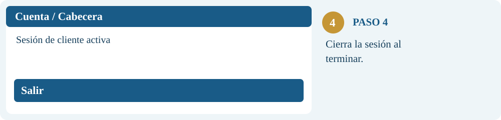

5. Si la sesión vence por inactividad, vuelve a **Iniciar sesión**. Por defecto vence a los **15 minutos**, aunque tu empresa puede configurar otro tiempo. Las actualizaciones automáticas no cuentan como actividad.

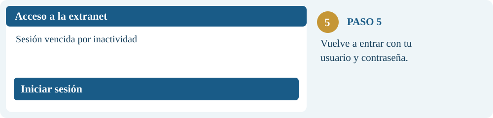

## Cómo mantener este manual

Edita `docs/manual/README.md` y las ilustraciones de `docs/manual/assets/`. Regenera la descarga con `python docs/manual/build_pdf.py` (requiere reportlab). El resultado se publica en `frontend/public/manual-guia-tareas.pdf`. Guarda y revisa los cambios en develop antes de pasarlos a producción.
