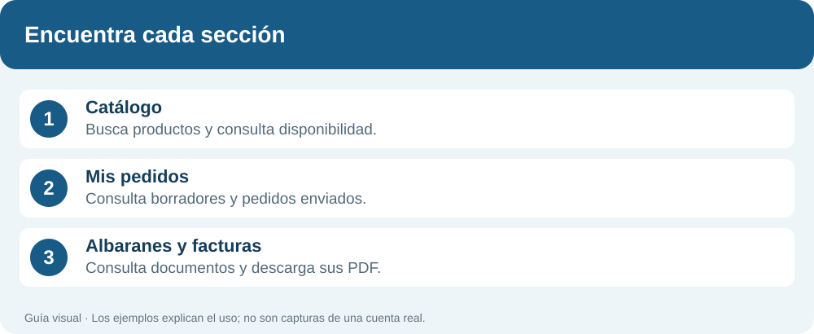
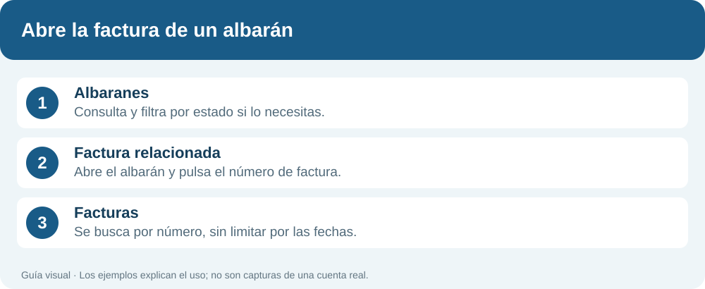
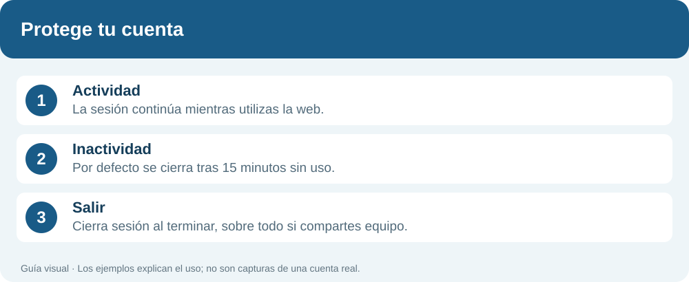

# Manual de uso · Bermúdez Ulloa

**Guía para clientes · Actualizado el 11 de octubre de 2026**

Busca tu material, prepara el pedido y consulta su evolución desde ordenador, tablet o móvil. Las ilustraciones son guías de pasos, no capturas de una cuenta real.

## Índice

1. [Entrar en la web](#1-entrar-en-la-web)
2. [Moverte por la web](#2-moverte-por-la-web)
3. [Buscar y añadir material](#3-buscar-y-añadir-material)
4. [Revisar el carrito](#4-revisar-el-carrito)
5. [Consultar tus pedidos](#5-consultar-tus-pedidos)
6. [Albaranes y facturas](#6-albaranes-y-facturas)
7. [Usar la web en el móvil](#7-usar-la-web-en-el-móvil)
8. [Sesión y seguridad](#8-sesión-y-seguridad)
9. [Resolver dudas](#9-resolver-dudas)

## 1. Entrar en la web

Abre la dirección de la extranet facilitada por tu empresa. Introduce tu **usuario o email** y **contraseña**, y pulsa **Iniciar sesión**. Si no puedes acceder, solicita ayuda a tu contacto de Bermúdez Ulloa.

## 2. Moverte por la web

| Opción | Para qué sirve |
|---|---|
| **Inicio** | Accesos rápidos, materiales favoritos y resumen de pedidos. |
| **Catálogo** | Buscar productos y consultar precio y disponibilidad. |
| **Mis pedidos** | Consultar pedidos, borradores, líneas e historial. |
| **Albaranes y facturas** | Consultar y descargar documentación comercial. |
| **Mi cuenta** | Consultar tus datos y cambiar la contraseña. |

**Menú** abre la navegación. **Catálogo profesional** permite ir al catálogo o explorar familias y subfamilias. **Todos los departamentos**, junto al buscador, limita la búsqueda a un departamento. El logo lleva a Inicio.

## 3. Buscar y añadir material

1. Escribe en el buscador un nombre, una referencia o una medida. Ejemplos: **racor latón**, **03065** o **1/2**.
2. Pulsa el botón de búsqueda. Si hay muchos resultados, afina por **departamento, familia, subfamilia o tipo de producto**.
3. Revisa la descripción, el precio y las unidades disponibles.
4. Indica la cantidad y pulsa **Añadir al carrito**.

Puedes repetir estos pasos con varios artículos. **Limpiar todo** elimina los filtros aplicados para ampliar la búsqueda. El precio con IVA y sin IVA se muestra en la ficha cuando está disponible.

## 4. Revisar el carrito

Pulsa **Mi carrito** para revisar el pedido. Puedes modificar las cantidades o quitar un artículo con **×**. Comprueba el subtotal, el IVA y el total.

Completa **Recoger en**, y si procede **Obra**, **Referencia cliente** y **Observaciones**.

| Botón u opción | Resultado |
|---|---|
| **Seguir comprando** | Cierra el carrito y vuelve al catálogo conservando los artículos de la sesión. |
| **×** en la cabecera | Cierra el carrito sin enviar el pedido. |
| **Guardar como borrador** | Guarda el pedido para revisarlo antes de enviarlo. |
| **Enviar pedido a tienda** | Envía el pedido a la tienda seleccionada. |

Guardar un borrador no equivale a enviarlo a preparación. Revisa siempre los datos antes de enviar.

## 5. Consultar tus pedidos

En **Mis pedidos**, selecciona **Desde**, **Hasta**, **Estado** y **Origen**, y pulsa **Consultar**. **Actualizar pedidos** vuelve a consultar con los filtros elegidos.

Abre **Ver detalle** para revisar artículos, cantidades pedidas y servidas, historial y documentos disponibles.

| Estado | Qué indica |
|---|---|
| **Borrador** | Guardado antes de enviarlo. |
| **Pendiente** | Pendiente de continuar el proceso. |
| **En procesamiento** | En proceso de preparación. |
| **Pendiente de recojo** | Pendiente de recogida. |
| **Entregado** | Entrega registrada. |
| **Facturado** | Facturación registrada. |

- **Duplicar pedido** permite preparar otro a partir de uno anterior. Revisa su contenido antes de enviarlo.
- **Convertir en pendiente** envía un borrador al siguiente estado.
- **Eliminar pedido** aparece únicamente en pedidos locales que cumplen las condiciones de eliminación. No aparece si el pedido ya tiene número EXIT. La eliminación requiere confirmación.

Al eliminar, desaparece solo ese pedido y se actualiza la lista con la última consulta. Si no ves un pedido, revisa fechas, estado y origen: los filtros pueden excluirlo.

## 6. Albaranes y facturas

### Consultar albaranes

Abre **Albaranes**, indica el número o las fechas y pulsa **Consultar**. El filtro **Estado (opcional)** permite elegir **Todos**, **Facturado** o **No facturado**; inicialmente muestra Todos.

Abre **Ver detalle** para ver los artículos despachados, cantidades e importes. Si el albarán tiene factura relacionada, pulsa **su número de factura**.

### Consultar facturas

La factura relacionada se abre en la pestaña **Facturas** mediante su número, **sin limitarla por las fechas del albarán**.

También puedes escribir un número de factura y pulsar **Consultar**. Cuando introduces un número, la búsqueda ignora las fechas. Si no indicas número, se utiliza el rango de fechas elegido.

- **Descargar PDF:** descarga el documento seleccionado.
- **Descargar Excel:** exporta los documentos según el número o rango de fechas indicado; no aplica el filtro opcional de estado de albaranes.
- **Imprimir listado:** abre la impresión del navegador sobre el listado visible.

## 7. Usar la web en el móvil

El logo y el buscador están en la parte superior. El catálogo muestra tarjetas adaptadas a la pantalla. Pulsa **Filtrar** para abrir los filtros y **Ver productos** para regresar al resultado.

La botonera inferior permite cambiar entre **Inicio**, **Buscar**, **Pedidos** y **Cuenta**. Para preparar el pedido, abre **Mi carrito**. Puedes salir del carrito con **Seguir comprando** sin enviarlo.

## 8. Sesión y seguridad

La sesión se mantiene mientras utilizas la web. **Por defecto caduca tras 15 minutos de inactividad**; la empresa puede configurar otro tiempo. Las actualizaciones automáticas de pantalla no cuentan como actividad del usuario.

Cuando venza la sesión, inicia sesión de nuevo. Al terminar, pulsa **Salir**, especialmente si el equipo es compartido. No confíes en las flechas del navegador para cerrar sesión.

## 9. Resolver dudas

| Situación | Qué hacer |
|---|---|
| No encuentro un producto | Prueba su referencia y limpia los filtros de categoría. |
| No veo un pedido | Revisa fechas, estado y origen, y pulsa Consultar. |
| No veo la factura relacionada | Pulsa su número en el albarán; la búsqueda no usa fechas. |
| Quiero seguir buscando sin enviar | Pulsa Seguir comprando en el carrito. |
| Quiero revisar el pedido más tarde | Guárdalo como borrador y búscalo en Mis pedidos. |
| La sesión ha caducado | Inicia sesión de nuevo. |
| No puedo eliminar un pedido | Solo se permite eliminar determinados pedidos locales sin número EXIT. |

---

## Cómo mantener este manual

La versión descargable se genera con `python docs/manual/build_pdf.py` (requiere reportlab) y se publica en `frontend/public/manual-de-uso.pdf`. Regenera el PDF cuando cambies texto o ilustraciones.

Este manual se mantiene en **`docs/manual/README.md`**, con ilustraciones editables en **`docs/manual/assets/`**. En GitHub, abre el archivo y utiliza **Edit** para proponer una actualización; dirige el cambio a **develop**. Actualiza también la fecha de revisión y las ilustraciones afectadas.

Describe únicamente funciones disponibles y comprueba los nombres de los botones. Si se añaden capturas reales, utiliza una cuenta de demostración y evita incluir datos de clientes. Git conserva el historial de versiones del manual.
